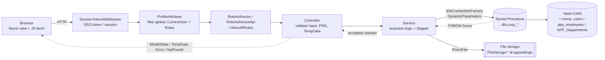
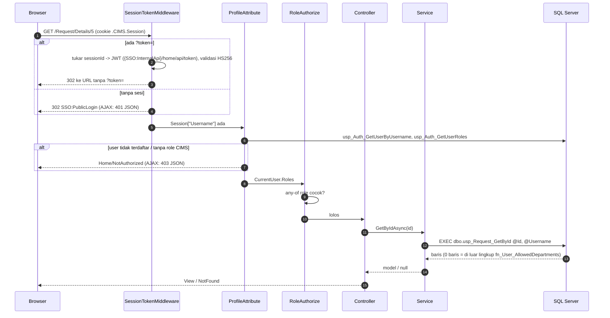
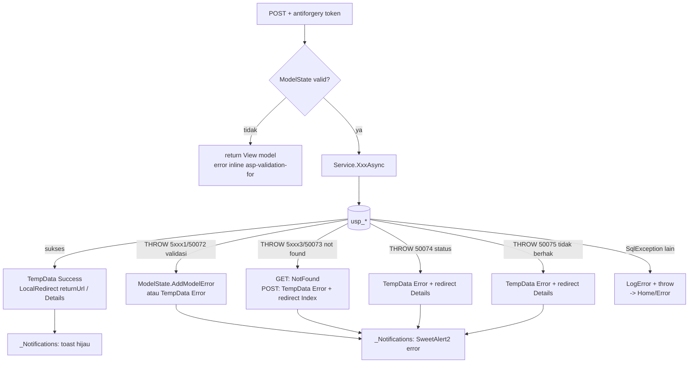
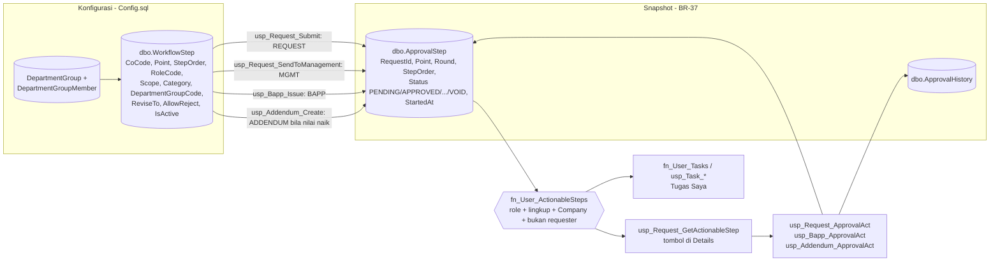
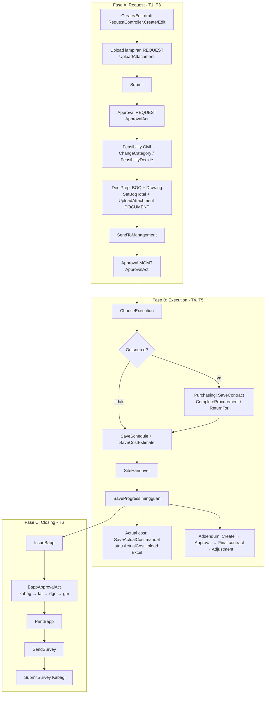

# 01. Flow Diagram untuk Developer

## 1. Arsitektur lapisan

Pola: **Controller → Service (Dapper) → Stored Procedure**. Tidak ada layer Repository, tidak ada Entity Framework.



| Lapisan | Folder | Tanggung jawab | Dilarang |
|---|---|---|---|
| Middleware | `Middleware/` | Tukar `?token=` ke JWT, simpan `Username` di Session, redirect ke login | Logging token/sessionId |
| Filter | `Filters/` | `ProfileAttribute` memuat `CurrentUser` + `Roles` sekali per request; default deny; `RoleAuthorize*` per action | String role literal (pakai `CimsRoles`) |
| Controller | `Controllers/` | Routing, validasi `ModelState`, mapping exception → UI, PRG | Akses Dapper/DB langsung, business logic |
| Service | `Services/` | Panggil SP lewat Dapper, terjemahkan `SqlException.Number` → exception domain, simpan file | Repository, SQL string concat |
| SP / fungsi | `Database/*.sql` | Aturan bisnis (status, lingkup data, workflow, validasi) | Dijalankan Claude ke production |

## 2. Alur satu HTTP request (urutan pipeline)



Urutan di `Program.cs`: `UseStaticFiles` → `UseRequestLocalization` → `UseRouting` → `UseSession` → `SessionTokenMiddleware` → `UseAuthorization`.

## 3. Alur POST (pola PRG + terjemahan error)



## 4. State machine status request (PRD 3.6)

Kode status di `Models/ProjectRequest.cs` (`RequestStatus`). Status hanya diubah oleh SP, bukan oleh C#.

```mermaid
stateDiagram-v2
    [*] --> DRAFT: usp_Request_SaveDraft (adm/plan/spv)
    DRAFT --> WAITING_APPROVAL: usp_Request_Submit (snapshot REQUEST)
    RETURNED --> WAITING_APPROVAL: usp_Request_Submit (ronde baru)
    DRAFT --> CANCELLED: usp_Request_Cancel
    RETURNED --> CANCELLED: usp_Request_Cancel
    WAITING_APPROVAL --> CANCELLED: Cancel (juga dari FEASIBILITY,<br/>DOC_PREPARATION, MGMT_APPROVAL; BR-09)

    WAITING_APPROVAL --> WAITING_APPROVAL: APPROVE, ada langkah berikut
    WAITING_APPROVAL --> FEASIBILITY: APPROVE langkah terakhir
    WAITING_APPROVAL --> RETURNED: REVISE (ReviseTo=REQUESTER)
    WAITING_APPROVAL --> REJECTED: REJECT

    FEASIBILITY --> DOC_PREPARATION: usp_Request_FeasibilityDecide YES
    FEASIBILITY --> RETURNED: FeasibilityDecide REVISE
    FEASIBILITY --> REJECTED: FeasibilityDecide REJECT

    DOC_PREPARATION --> MGMT_APPROVAL: usp_Request_SendToManagement (snapshot MGMT)
    MGMT_APPROVAL --> PLANNING: APPROVE langkah terakhir
    MGMT_APPROVAL --> FEASIBILITY: REVISE (ReviseTo=CIVIL)
    MGMT_APPROVAL --> REJECTED: REJECT

    PLANNING --> SCHEDULING: usp_Request_ChooseExecution INHOUSE
    PLANNING --> PROCUREMENT: ChooseExecution OUTSOURCE (TOR)
    PROCUREMENT --> PLANNING: usp_Request_ReturnTor
    PROCUREMENT --> SCHEDULING: usp_Request_CompleteProcurement

    SCHEDULING --> IN_PROGRESS: usp_Request_SiteHandover
    IN_PROGRESS --> BAPP_REVIEW: usp_Bapp_Issue (snapshot BAPP)
    BAPP_REVIEW --> IN_PROGRESS: usp_Bapp_ApprovalAct No
    BAPP_REVIEW --> CLOSED: Accept langkah terakhir
    CLOSED --> SURVEY_COMPLETED: usp_Survey_Submit

    REJECTED --> [*]
    CANCELLED --> [*]
    SURVEY_COMPLETED --> [*]
```

Catatan:
- **Running project / emergency** (`usp_Request_CreateRunning`, `RequestMigration.sql`) langsung masuk `PLANNING` atau `SCHEDULING` (`@TargetStatus`), tanpa langkah approval REQUEST/MGMT. `usp_Request_Submit` hanya menerima `DRAFT`/`RETURNED`; `usp_Request_Cancel` menerima `DRAFT` s.d. `MGMT_APPROVAL`.
- **Addendum** (titik `ADDENDUM`) berjalan **tanpa mengubah status request**; request tetap `SCHEDULING`/`IN_PROGRESS`, status addendum ada di `dbo.ProjectAddendum`.

## 5. Alur approval (workflow dinamis, PRD 3.9)

Empat titik approval. Langkah dibaca dari `dbo.WorkflowStep` dan **di-snapshot** ke `dbo.ApprovalStep` saat titik dimulai (BR-37). Aksi approver selalu membaca snapshot, bukan tabel workflow.



```mermaid
sequenceDiagram
    autonumber
    participant Req as Requester (adm)
    participant SP as usp_Request_Submit
    participant Kb as Kabag
    participant Mo as MO (grup MILL)
    participant Act as usp_Request_ApprovalAct

    Req->>SP: Submit
    SP->>SP: ambil WorkflowStep (CoCode, 'REQUEST', Category, grup dept), skip yg kondisinya tidak cocok (BR-52)
    SP->>SP: INSERT ApprovalStep ronde N; langkah 1 StartedAt = now; status WAITING_APPROVAL
    Kb->>Act: APPROVE (StepId yang dilihat)
    Act->>Act: UPDLOCK request; cek step masih PENDING (50074) dan user berhak (50075)
    Act->>Act: langkah 1 APPROVED, langkah 2 StartedAt = now
    Mo->>Act: APPROVE
    Act->>Act: tidak ada langkah berikut -> FEASIBILITY
    Note over Act: REVISE: VOID sisa langkah, status sesuai ReviseTo<br/>REJECT: hanya bila AllowReject = 1, VOID sisa langkah
```

## 6. Alur fitur utama per fase



## 7. Urutan menjalankan script SQL (DB dev/test)

Semua script idempotent (`CREATE OR ALTER`, `IF OBJECT_ID ... IS NULL`, seed `MERGE` hanya menambah). Urutan dari header "Jalankan SETELAH" di masing-masing file:

```mermaid
flowchart LR
    R[Role.sql] --> AU[Auth.sql] --> CF[Config.sql] --> APS[AppSetting.sql] --> SC[Scope.sql]
    SC --> MD[Master: Customer, Location,<br/>AttachmentType, AssessmentQuestion,<br/>SurveyTemplateItem, SubCategory, Unit, Vendor]
    MD --> RQ[Request.sql] --> RS[RequestSubmit.sql] --> RAp[RequestApproval.sql] --> TK[Task.sql]
    TK --> RF[RequestFeasibility.sql] --> RD[RequestDocPrep.sql] --> RE[RequestExecution.sql]
    RE --> RSc[RequestSchedule.sql] --> RP[RequestProgress.sql] --> RAC[RequestActualCost.sql]
    RAC --> RAU[RequestActualUpload.sql] --> RM[RequestMigration.sql] --> RAd[RequestAddendum.sql]
    RAd --> RB[RequestBapp.sql] --> RSv[RequestSurvey.sql] --> DB1[Dashboard.sql] --> DB2[DashboardChart.sql]
```



Bila sebuah file menyebut "dijalankan ulang" (mis. `RequestActualCost.sql` meminta `RequestSchedule.sql` dijalankan ulang), ikuti catatan di header file tersebut. File berisi karakter non-ASCII wajib **UTF-8 dengan BOM** (lihat `FixTextEncoding.sql` bila teks sudah rusak).
