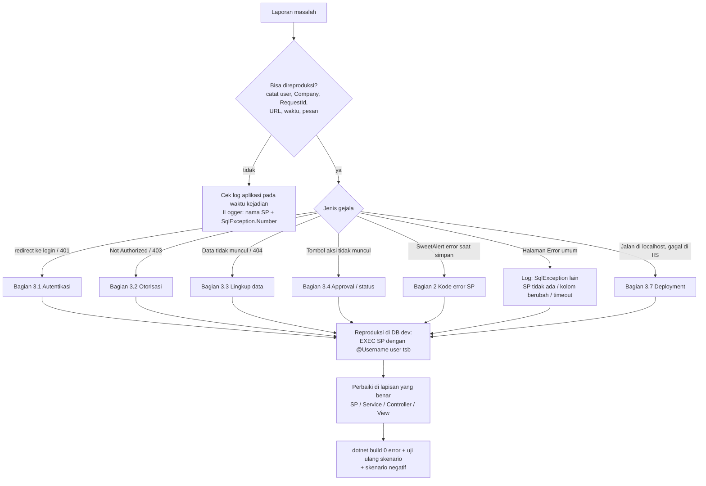

# 03. Best Practice Troubleshooting

Prinsip (sesuai `CLAUDE.md`): **cari root cause dulu, perbaiki dengan perubahan terkecil yang aman, jangan menebak.** Sebagian besar aturan bisnis CIMS ada di stored procedure, jadi banyak "bug UI" sebenarnya adalah SP yang menolak dengan benar (status, lingkup, role).

## 1. Alur diagnosis



**Langkah standar:**

1. **Kumpulkan fakta**: username, Company (ABL/NKM), RequestId/RequestNo, status request, aksi yang dilakukan, pesan persis, waktu.
2. **Lihat log** (`ILogger`): Service mencatat `"{Procedure}: ..."` dengan nama SP. `LogWarning` = SP menolak dengan sengaja (50072–50075); `LogError` = error tak terduga.
3. **Petakan** action → Service → SP lewat [02-Function-Map.md](02-Function-Map.md).
4. **Reproduksi langsung di DB dev** dengan parameter dan `@Username` yang sama. Setiap file `Database/*.sql` punya blok `TEST` di bagian bawah sebagai contoh panggilan.
5. **Tentukan lapisan** yang salah: data/konfigurasi (tabel workflow, role, master), SP, Service (mapping parameter/exception), Controller (role atribut, validasi), View/JS (kondisi tampil, URL).
6. **Perbaiki minimal**, `dotnet build`, uji skenario positif **dan** negatif (user lain, role lain, status lain).
7. **Laporkan** dengan format `Diagnosis / Root Cause / Perubahan / Test / Expected Result`.

## 2. Kode error stored procedure

| Nomor | Modul | Arti | Cek pertama |
|---|---|---|---|
| 50001–50003 | Customer | duplikat kode / validasi / tidak ditemukan | data master |
| 50011–50013 | Location | duplikat nama / validasi / tidak ditemukan | |
| 50021–50023 | AttachmentType | duplikat kode / validasi / tidak ditemukan | |
| 50031–50033 | AssessmentQuestion | | |
| 50041–50043 | SurveyTemplateItem | | |
| 50052–50053 | AppSetting | nilai tidak valid / key tidak ada | `ValueType` setting |
| 50061–50064 | SubCategory | (+50064 nama duplikat) | |
| 50081–50084 | Vendor | (+50084 ERP no duplikat) | |
| 50091–50093 | Unit | | |
| **50072** | Semua transaksi Request | input wajib kosong / syarat belum lengkap (mis. lampiran wajib, total bobot ≠ 100%, total estimasi ≠ plan cost) | pesan SP menyebut syaratnya |
| **50073** | | request tidak ada **atau di luar lingkup user** | `fn_User_AllowedDepartments`, `fn_Request_VisibleToUser` |
| **50074** | | status tidak mengizinkan aksi / langkah sudah diproses orang lain / addendum terbuka | `ProjectRequest.Status`, `ApprovalStep`, `ProjectAddendum.Status` |
| **50075** | | role / lingkup / Company tidak cocok, atau approve request sendiri | `fn_User_ActionableSteps`, `home..users.Role` |

Pesan `THROW` sudah berbahasa Inggris dan ditampilkan ke user apa adanya, jadi baca pesannya dulu sebelum membuka kode.

## 3. Gejala umum dan penyebab

### 3.1 Autentikasi (redirect ke login, loop, 401)

| Gejala | Penyebab umum | Cek |
|---|---|---|
| Selalu kembali ke portal login | Cookie `.CIMS.Session` hilang (HTTPS/`SameSite`, beda host), Session store di-reset (app pool recycle) | DevTools → cookie; event log IIS recycle |
| Gagal start di server | `SSO:JwtKey` kosong di non-Development | env var `SSO__JwtKey` di app pool / konfigurasi server |
| Token ditolak | Kunci JWT beda dengan portal, jam server berbeda (exp) | log `SessionTokenMiddleware` (tanpa mencatat token) |
| Dev lokal tanpa SSO | `Auth:DevUsername` kosong di `appsettings.Development.json` | isi username uji; hanya berlaku di Development |

### 3.2 Otorisasi (Not Authorized / 403)

| Gejala | Penyebab umum | Cek |
|---|---|---|
| Semua halaman Not Authorized | User tidak ada / resign di `home..users`/`app_employees`, atau tidak punya role di `CimsRoles.All` | `EXEC dbo.usp_Auth_GetUserByUsername @Username='x'`; `EXEC dbo.usp_Auth_GetUserRoles @Username='x'` |
| Role ada di portal tapi tidak terbaca | Kode role di `home..users.Role` tidak ada di `dbo.HierarchyLevel`, salah ketik, spasi, pemisah bukan `;` | `SELECT [Role] FROM home..users WHERE Username='x'`; `SELECT * FROM dbo.HierarchyLevel` |
| Satu action 403 | Role tidak ada di `[RoleAuthorize(...)]` action itu | atribut di controller vs matriks PRD 5.2 |
| Menu tampil tapi halaman 403 | `MenuItem.Roles` di `_Sidebar.cshtml` tidak sinkron dengan atribut controller (sidebar hanya kosmetik) | samakan keduanya |

### 3.3 Data tidak muncul / 404 / 50073

- Hampir selalu **lingkup data**: SP list/detail membatasi lewat `dbo.fn_User_AllowedDepartments(@Username)` dan Company user.
- Cek: `SELECT * FROM dbo.fn_User_AllowedDepartments('x')` dan bandingkan dengan `ProjectRequest.DepartmentID`/`CoCode`.
- Penyebab lain: filter list (Company, status, kategori) terbawa di query string; `IsActive = 0` pada master; karyawan pindah departemen di portal.

### 3.4 Tombol Approve / aksi tidak muncul, tugas tidak ada di Tugas Saya

Tombol approval muncul hanya bila `usp_Request_GetActionableStep` mengembalikan 1 baris. Cek berurutan:

```sql
-- 1. Status request dan langkah snapshot ronde terakhir
SELECT Id, RequestNo, CoCode, DepartmentID, Category, Status, RequesterUsername FROM dbo.ProjectRequest WHERE Id = @Id;
SELECT * FROM dbo.ApprovalStep WHERE RequestId = @Id ORDER BY [Point], Round, StepOrder;

-- 2. Apakah user dianggap berhak?
SELECT * FROM dbo.fn_User_ActionableSteps(N'username') WHERE RequestId = @Id;

-- 3. Riwayat aksi
SELECT * FROM dbo.ApprovalHistory WHERE RequestId = @Id ORDER BY ActionAt;
```

| Hasil | Arti |
|---|---|
| Tidak ada langkah `PENDING` dengan `StartedAt` terisi | Langkah sebelumnya belum diproses, atau ronde sudah ditutup (VOID) |
| Langkah aktif ada, tapi `fn_User_ActionableSteps` kosong | User tidak punya `RoleCode` langkah, beda Company (BR-63), ABRV beda untuk scope `DEPT` (BR-24), departemen tidak ada di grup untuk scope `GROUP`, atau user = requester (BR-30) |
| Status request tidak sesuai titik | REQUEST harus `WAITING_APPROVAL`, MGMT `MGMT_APPROVAL`, BAPP `BAPP_REVIEW`, ADDENDUM `SCHEDULING`/`IN_PROGRESS` |
| Langkah yang diharapkan tidak ada di snapshot | Kondisi `Category`/`DepartmentGroupCode` tidak terpenuhi saat snapshot (BR-52) atau `WorkflowStep` diubah **setelah** snapshot (BR-37: tidak berlaku surut) |

Aksi Civil (Feasibility, Schedule, dsb.) bukan langkah workflow; tombolnya ditentukan status request + role di `Details` (`RequestController.Details`, flag `canXxx`) dan view partial.

### 3.5 Upload / download file

| Gejala | Cek |
|---|---|
| "File type not allowed" / terlalu besar | `dbo.AttachmentType.AllowedExtensions`, `MaxSizeMB` (dinormalisasi `fn_AttachmentType_NormalizeExt`); batas request IIS `maxAllowedContentLength` |
| Upload gagal di server, lokal OK | Folder `FileStorage:*` (default `D:\APP_DATA\CIMSAttachments`) tidak ada / identity app pool tidak punya hak tulis |
| Download 404 | Baris ada tapi file fisik hilang/dipindah; path relatif vs root `FileStorage` beda antar server |
| Jenis lampiran tidak muncul | Stage salah untuk status (`RequestAttachmentService.StageForStatus`) atau `IsActive = 0` |

### 3.6 Angka / perhitungan

| Gejala | Lokasi logika |
|---|---|
| % progress, status jadwal | `usp_Request_SaveProgress`, `fn_Request_PlanProgress`, `usp_Request_RefreshScheduleSummary` (`RequestProgress.sql`) |
| Status biaya, plan cost | `usp_Request_RefreshCostStatus` (`RequestActualCost.sql`); plan cost dari kontrak/BOQ/addendum |
| Batas hari kerja (emergency) | `fn_WorkingDaysBetween`, `WorkCalendarWeekend`, `WorkCalendarHoliday`, `home..APP_Holidays`, `AppSetting EMERGENCY_FOLLOWUP_WORKDAYS` |
| Dashboard beda dengan detail | `usp_Dashboard_*` memakai filter bulan/Company; bandingkan parameter yang sama |
| Teks `·`, `→` di UI | Script SQL disimpan tanpa BOM → jalankan ulang dengan UTF-8 BOM; perbaiki data dengan `FixTextEncoding.sql` |

### 3.7 Lokal jalan, setelah publish ke IIS gagal

Periksa **sebelum** menyimpulkan bug kode: publish output lengkap, `ASPNETCORE_ENVIRONMENT`, `appsettings.{Env}.json`, connection string + hak login SQL (termasuk `SELECT` ke DB `home`), virtual directory (URL AJAX wajib `@Url.Action`, bukan `/api/...` hardcode), binding HTTPS, static files (`wwwroot/lib`), hak folder `FileStorage`, identity app pool, firewall, log stdout (`web.config` `stdoutLogEnabled`).

## 4. Aturan saat memperbaiki

- **Jangan** mengubah data production langsung untuk "membuka" alur (mis. `UPDATE ProjectRequest SET Status=...`). Bila perlu koreksi data, tulis script terpisah, uji di dev, minta persetujuan, catat di riwayat.
- Bila SP menolak dengan benar sesuai PRD, itu **bukan bug**: jelaskan aturan (ID BR/ST) ke user.
- Perubahan SP: edit file `Database/*.sql` (bukan langsung di SSMS saja), tetap `CREATE OR ALTER`, simpan UTF-8 BOM bila ada non-ASCII, jalankan ulang file di dev, jalankan blok TEST.
- Perubahan kolom tabel: script migrasi terpisah dan idempotent, konfirmasi dulu.
- Jangan menelan exception; error tak terduga harus `LogError` dan dilempar ulang (pola `Translate`).
- Jangan mencatat token, sessionId, atau isi file ke log.
- Setelah fix: `dotnet build` 0 error, uji di lebar 360px bila menyentuh view, perbarui dokumen `docs/dev` bila mengubah peta fungsi.

## 5. Query diagnosis cepat

```sql
-- Profil & role user
EXEC dbo.usp_Auth_GetUserByUsername @Username = N'x';
EXEC dbo.usp_Auth_GetUserRoles     @Username = N'x';
SELECT * FROM dbo.fn_User_AllowedDepartments(N'x');

-- Tugas user (sumber Tugas Saya)
EXEC dbo.usp_Task_GetList @Username = N'x', @TaskType = NULL;

-- Workflow yang akan dipakai untuk request baru
EXEC dbo.usp_Workflow_GetSteps @CoCode = 'ABL', @Point = 'REQUEST', @Category = 'OPEX', @DepartmentID = 19;

-- Konfigurasi
SELECT * FROM dbo.WorkflowStep ORDER BY CoCode, [Point], StepOrder;
SELECT g.CoCode, g.GroupCode, m.DepartmentID FROM dbo.DepartmentGroup g JOIN dbo.DepartmentGroupMember m ON m.GroupId = g.Id;
EXEC dbo.usp_AppSetting_Get @CoCode = 'ABL', @SettingKey = 'EMERGENCY_FOLLOWUP_WORKDAYS';

-- Riwayat lengkap satu request
SELECT * FROM dbo.ApprovalHistory WHERE RequestId = @Id ORDER BY ActionAt;
SELECT * FROM dbo.RequestCategoryChange WHERE RequestId = @Id;
SELECT * FROM dbo.ProjectAddendum WHERE RequestId = @Id;
SELECT * FROM dbo.ProjectBapp WHERE RequestId = @Id;
```
