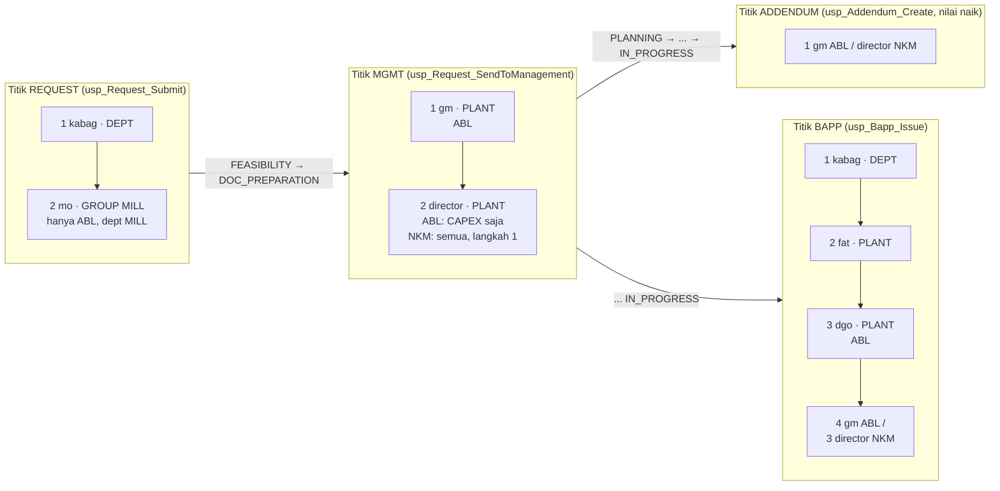
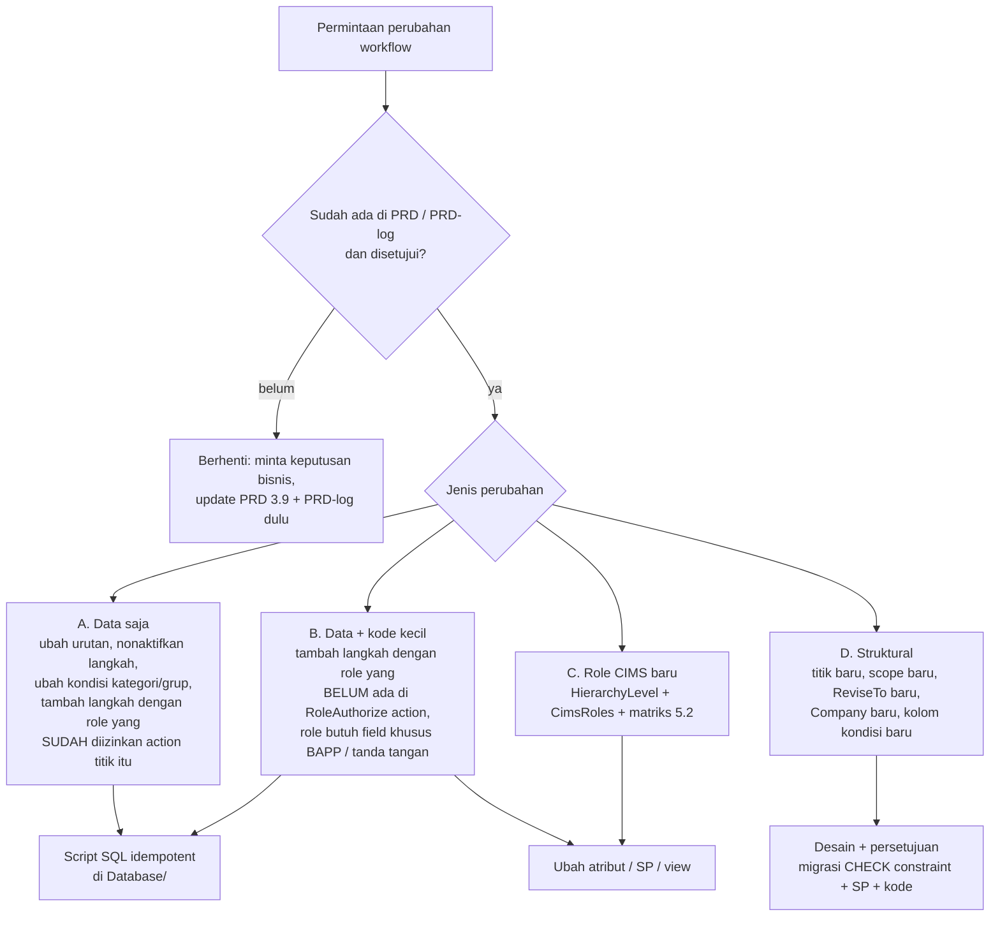

# 04. Alur Workflow dan Best Practice Perubahan Workflow

Referensi bisnis: PRD 3.1–3.4 (alur), 3.6 (status), 3.9 (workflow dinamis), BR-37, BR-38, BR-39, BR-52, BR-53, BR-63.

## 1. Apa yang dinamis dan apa yang tetap

| Bagian | Sifat | Tempat |
|---|---|---|
| Rantai approval di 4 titik: `REQUEST`, `MGMT`, `BAPP`, `ADDENDUM` (urutan, role, lingkup, kondisi kategori/grup, Revise ke mana, boleh Reject, aktif) | **Dinamis (data)** | `dbo.WorkflowStep` (`Config.sql`) |
| Anggota grup departemen (MILL, lingkup MO) | **Dinamis (data)** | `dbo.DepartmentGroup`, `dbo.DepartmentGroupMember` |
| Nilai ambang, batas hari kerja, libur | **Dinamis (data)** | `dbo.AppSetting`, `WorkCalendarWeekend`, `WorkCalendarHoliday` |
| Tahapan operasional Civil: Feasibility, Doc Preparation, Planning, Procurement, Scheduling, In Progress, Closing, Survey | **Tetap (kode)** | SP per tahap + `RequestController` + view |
| Daftar status request | **Tetap (kode)** | `RequestStatus` (`Models/ProjectRequest.cs`) + SP |
| Role yang boleh memanggil action approval | **Tetap (kode)** | `[RoleAuthorize]` di `RequestController` |
| Field khusus per role di BAPP (Kabag: hasil pemeriksaan; FAT: no outstanding; DGO: status CLOSED) dan kolom tanda tangan cetak | **Tetap (kode)** | `usp_Bapp_ApprovalAct`, `_BappCard.cshtml`, `PrintBapp.cshtml` |

## 2. Alur workflow saat ini (default seed)



Mekanisme inti:

1. **Snapshot (BR-37).** Saat titik dimulai, SP menyalin `WorkflowStep` aktif yang kondisinya cocok ke `dbo.ApprovalStep` (dengan `Round` baru). Langkah yang kondisinya tidak cocok dilewati (BR-52). MGMT di-snapshot saat **Send to Management**, bukan saat Submit (BR-53).
2. **Siapa yang boleh bertindak** dihitung oleh `dbo.fn_User_ActionableSteps(@Username)` dari snapshot: langkah `PENDING` + `StartedAt` terisi di ronde terakhir, status request sesuai titik, user memegang `RoleCode`, Company sama (BR-63), lingkup `DEPT`/`GROUP`/`PLANT` cocok, bukan requester (BR-30). Fungsi ini dipakai tombol di Details **dan** Tugas Saya.
3. **Aksi** (`usp_Request_ApprovalAct`, `usp_Bapp_ApprovalAct`, `usp_Addendum_ApprovalAct`): APPROVE → langkah berikut di-`StartedAt`; tanpa langkah berikut → status berikut. REVISE → sesuai `ReviseTo`, sisa langkah VOID. REJECT → hanya bila `AllowReject = 1`. Yang pertama berlaku (UPDLOCK + `@StepId`, BR-39).

Kode `ReviseTo` yang didukung SP: `REQUESTER` (→ `RETURNED`) dan `CIVIL` (→ `FEASIBILITY`; titik BAPP → `IN_PROGRESS`). Titik BAPP hanya bisa diproses lewat `usp_Bapp_ApprovalAct` (`SESSION_CONTEXT 'BappAct'`).

## 3. Klasifikasi perubahan



### Role yang diizinkan per action approval (cek sebelum menambah langkah)

| Titik | Action | `[RoleAuthorize]` saat ini |
|---|---|---|
| REQUEST, MGMT | `RequestController.ApprovalAct` | kabag, mo, gm, director |
| BAPP | `RequestController.BappApprovalAct` | kabag, fat, dgo, gm, director |
| ADDENDUM | `RequestController.AddendumApprovalAct` | kabag, mo, gm, director |

Contoh: menambah langkah `fat` di titik MGMT = jenis **B** (perlu menambah `CimsRoles.Fat` di `ApprovalAct`). Menambah `director` untuk OPEX di ABL = jenis **A** (cukup ubah `Category` langkah menjadi `NULL`).

## 4. Prosedur standar (semua jenis)

1. **Keputusan bisnis**: pastikan perubahan tercatat di `docs/PRD.md` 3.9 (tabel default) dan `docs/PRD-log.md`. Konflik dengan PRD → berhenti dan tanyakan.
2. **Analisis dampak** (checklist bagian 6).
3. **Tulis script** di `Database/` (file baru mis. `Database/WorkflowChange_YYYYMMDD.sql` atau blok baru di file modul terkait), **idempotent**, mengisi `UpdatedAt`/`UpdatedBy` (BR-38), UTF-8 BOM bila ada non-ASCII.
4. **Ubah kode** bila jenis B/C/D; `dotnet build` 0 error.
5. **Uji di DB dev** (bagian 7) termasuk request yang sudah berjalan.
6. **Deploy**: script dijalankan administrator/DBA di production (Claude tidak menjalankan script ke production), lalu publish aplikasi bila ada perubahan kode. Urutan: SQL dulu bila kode baru bergantung pada SP baru.
7. **Komunikasi**: beri tahu user bahwa perubahan **hanya berlaku untuk request/BAPP/addendum baru** (BR-37); update user guide role terkait bila perlu.

## 5. Resep per kasus

### 5.1 Menambah langkah di tengah (contoh nyata: DGO di BAPP ABL, `RequestBapp.sql`)

`UQ_WorkflowStep_Order (CoCode, Point, StepOrder)` unik, jadi geser urutan dulu (dari urutan terbesar), baru sisipkan:

```sql
/* Contoh: sisipkan 'fat' sebagai langkah 2 titik MGMT ABL (gm 1, fat 2, director 3) */
SET XACT_ABORT ON;
BEGIN TRAN;

IF NOT EXISTS (SELECT 1 FROM dbo.WorkflowStep WHERE CoCode = 'ABL' AND [Point] = 'MGMT' AND RoleCode = 'fat')
BEGIN
    -- geser langkah >= 2 satu posisi, mulai dari yang terbesar (hindari bentrok unique)
    DECLARE @o INT = (SELECT MAX(StepOrder) FROM dbo.WorkflowStep WHERE CoCode = 'ABL' AND [Point] = 'MGMT');
    WHILE @o >= 2
    BEGIN
        UPDATE dbo.WorkflowStep
        SET    StepOrder = StepOrder + 1, UpdatedAt = SYSDATETIME(), UpdatedBy = N'<admin>'
        WHERE  CoCode = 'ABL' AND [Point] = 'MGMT' AND StepOrder = @o;
        SET @o -= 1;
    END

    INSERT INTO dbo.WorkflowStep (CoCode, [Point], StepOrder, RoleCode, Scope, Category, DepartmentGroupCode, ReviseTo, AllowReject, CreatedBy)
    VALUES ('ABL', 'MGMT', 2, 'fat', 'PLANT', NULL, NULL, 'CIVIL', 1, N'<admin>');
END

COMMIT;

SELECT * FROM dbo.WorkflowStep WHERE CoCode = 'ABL' AND [Point] = 'MGMT' ORDER BY StepOrder;
```

Lalu (karena `fat` belum diizinkan di `ApprovalAct`) tambahkan `CimsRoles.Fat` pada `[RoleAuthorize]` action `ApprovalAct` di `RequestController`, dan cek `Views/Request/Details.cshtml`/`request-approval.js` tidak memfilter role.

### 5.2 Menambah langkah di akhir

`INSERT` dengan `StepOrder = MAX + 1`. Perhatikan: langkah terakhir menentukan transisi status akhir (REQUEST → FEASIBILITY, MGMT → PLANNING, BAPP → CLOSED). Untuk BAPP, cetak Berita Acara memakai tanda tangan langkah final `gm`/`director` (`PrintBapp.cshtml`) → jenis **B**.

### 5.3 Menonaktifkan / menghapus langkah

**Jangan `DELETE`** baris `WorkflowStep`: `ApprovalStep.WorkflowStepId` menyimpan asal definisi untuk penelusuran (BR-38), dan baris nonaktif tetap menjadi jejak audit. Gunakan:

```sql
UPDATE dbo.WorkflowStep SET IsActive = 0, UpdatedAt = SYSDATETIME(), UpdatedBy = N'<admin>'
WHERE CoCode = 'ABL' AND [Point] = 'REQUEST' AND RoleCode = 'mo';
```

Celah `StepOrder` (mis. 1, 3) aman karena SP memakai urutan, bukan nilai berurutan; rapikan hanya bila perlu.

### 5.4 Mengubah kondisi langkah

- Berlaku untuk kategori tertentu: `Category = 'CAPEX'` (NULL = semua).
- Berlaku untuk grup departemen: `DepartmentGroupCode = 'MILL'`; anggota grup di `DepartmentGroupMember` (DepartmentID dari `home..APP_Departments`). Menambah departemen ke MILL juga mengubah **lingkup data role `mo`**.
- Preview hasil tanpa membuat request: `EXEC dbo.usp_Workflow_GetSteps 'ABL', 'MGMT', 'OPEX', @DepartmentID;`

### 5.5 Menambah role CIMS baru (jenis C)

1. `dbo.HierarchyLevel` (seed `MERGE` di `Role.sql`): kode role + level + `Description`.
2. `Filters/CimsRoles.cs`: konstanta baru + masukkan ke `All` (default deny menolak role di luar `All`).
3. Tentukan hak per action sesuai **matriks PRD 5.2**; tambahkan di `[RoleAuthorize]` terkait dan `MenuItem.Roles` di `_Sidebar.cshtml`.
4. Lingkup data: perbarui `fn_User_AllowedDepartments` (`Scope.sql`) dan fungsi `fn_User_CanSee*` bila role perlu melihat modul tertentu.
5. Assign role ke user di `home..users.Role` (dipisah `;`).
6. Baru kemudian pakai role itu di `WorkflowStep`.

### 5.6 Perubahan struktural (jenis D) — wajib desain + persetujuan

| Perubahan | Yang harus diubah |
|---|---|
| Titik approval baru | CHECK `CK_WorkflowStep_Point` dan `CK_ApprovalStep_Point` (migrasi DROP/ADD constraint, pola `RequestAddendum.sql`), SP snapshot baru, pemetaan status di `fn_User_ActionableSteps`, SP aksi, `fn_User_Tasks`/`usp_Task_*`, action + atribut + view |
| Scope baru (selain DEPT/GROUP/PLANT) | CHECK `CK_WorkflowStep_Scope`, cabang lingkup di `fn_User_ActionableSteps` |
| Tujuan Revise baru | CHECK `CK_WorkflowStep_ReviseTo`, cabang `@ReviseTo` di `usp_Request_ApprovalAct` (dan status tujuan) |
| Company baru | CHECK `CoCode` di `WorkflowStep`, `AppSetting`, `WorkCalendar*`, seed workflow + kalender, `fn_User_AllowedDepartments` |
| Kolom kondisi baru di `WorkflowStep` (mis. ambang nilai) | Logika snapshot **diduplikasi di 4 SP**: `usp_Request_Submit` (`RequestSubmit.sql`), `usp_Request_SendToManagement` (`RequestDocPrep.sql`), `usp_Bapp_Issue` (`RequestBapp.sql`), `usp_Addendum_Create` (`RequestAddendum.sql`) + `usp_Workflow_GetSteps` (`Config.sql`). Semua harus diubah konsisten. |

## 6. Checklist dampak

- [ ] PRD 3.9 dan PRD-log sudah diperbarui dan disetujui.
- [ ] Role langkah ada di `dbo.HierarchyLevel` dan `CimsRoles.All`.
- [ ] Role langkah diizinkan oleh `[RoleAuthorize]` action titik tersebut (tabel bagian 3).
- [ ] Ada user aktif yang memegang role itu **di Company yang benar** (dan ABRV yang benar untuk scope `DEPT`); tanpa itu request akan macet di langkah tersebut.
- [ ] `ReviseTo` / `AllowReject` sesuai titik (REQUEST: REQUESTER; MGMT: CIVIL; BAPP: CIVIL + AllowReject 0; ADDENDUM: tanpa Revise, Reject = addendum batal).
- [ ] Langkah terakhir masih benar (status akhir; tanda tangan cetak BAPP).
- [ ] Field khusus role BAPP (`usp_Bapp_ApprovalAct`, `_BappCard.cshtml`) dan kolom tanda tangan (`PrintBapp.cshtml`) bila mengubah titik BAPP.
- [ ] Request/BAPP/addendum yang **sedang berjalan** tetap memakai snapshot lama (BR-37). Bila bisnis meminta berlaku surut, itu keputusan terpisah dengan script migrasi `ApprovalStep` khusus yang diuji dan disetujui — bukan bagian perubahan workflow biasa.
- [ ] User guide role terkait (`docs/CIMS-User-Guide-*.docx`) diperbarui bila alur yang dilihat user berubah.

## 7. Skenario uji (DB dev)

```sql
-- 0. Preview langkah yang akan di-snapshot
EXEC dbo.usp_Workflow_GetSteps 'ABL', 'MGMT', 'OPEX', 19;   -- dept MILL
EXEC dbo.usp_Workflow_GetSteps 'ABL', 'MGMT', 'OPEX', 6;    -- dept non-MILL
EXEC dbo.usp_Workflow_GetSteps 'ABL', 'MGMT', 'CAPEX', 6;
EXEC dbo.usp_Workflow_GetSteps 'NKM', 'MGMT', 'OPEX', 5003;

-- 1. Buat request uji lewat aplikasi (atau blok TEST di RequestSubmit.sql), Submit / Send to Management
-- 2. Snapshot sesuai harapan?
SELECT [Point], Round, StepOrder, RoleCode, Scope, Status, StartedAt FROM dbo.ApprovalStep WHERE RequestId = @Id ORDER BY [Point], Round, StepOrder;
-- 3. Approver langkah baru melihat tugas?
SELECT * FROM dbo.fn_User_ActionableSteps(N'<user role baru>') WHERE RequestId = @Id;
EXEC dbo.usp_Task_GetList @Username = N'<user role baru>', @TaskType = 'APPROVAL';
```

Uji lewat aplikasi (login sebagai tiap approver, `Auth:DevUsername` di Development):

1. Approve berurutan sampai status akhir benar.
2. Revise di langkah baru → status tujuan benar, sisa langkah VOID, resubmit membuat ronde baru dengan langkah baru.
3. Reject (bila `AllowReject = 1`) → `REJECTED`; tombol Reject tidak tampil bila 0.
4. User role yang sama tapi Company/ABRV lain **tidak** melihat tombol maupun tugas.
5. Request yang dibuat **sebelum** perubahan tetap mengikuti langkah lama.
6. Cek Tugas Saya, Dashboard, riwayat approval di Details, dan (BAPP) halaman cetak.
